# Creative Theme System — AI Agent Skill

A portable skill for creating and integrating **11 selectable website themes**, with working CSS, a safe starter generator, and a complete browser demo. Instructions are in English so different AI agents can reuse them.

**Entry point: [SKILL.md](SKILL.md).** Any agent with filesystem access can read it; agents with an existing application should follow the integration path rather than replacing the app.

## Included themes

Botanical · Editorial · Playroom · Midnight · Playful Retro Neo-Brutalism · Command line (black/white/gray) · Visual Studio Code · Excel · Canva · Figma · Photoshop.

The app-inspired styles are visual references, not integrations with or replicas of those products. Sample products are fictional; SVG artwork is original. There are no store credentials, original product photographs, customer data, account identifiers or payment functionality in the starter.

## Theme screenshots

Actual desktop screenshots of the bundled starter, captured at the same viewport with the same fictional sample content. Click any preview to open the full-size image.

| Studio collection | Studio collection |
| --- | --- |
| **01 · Botanical**<br>[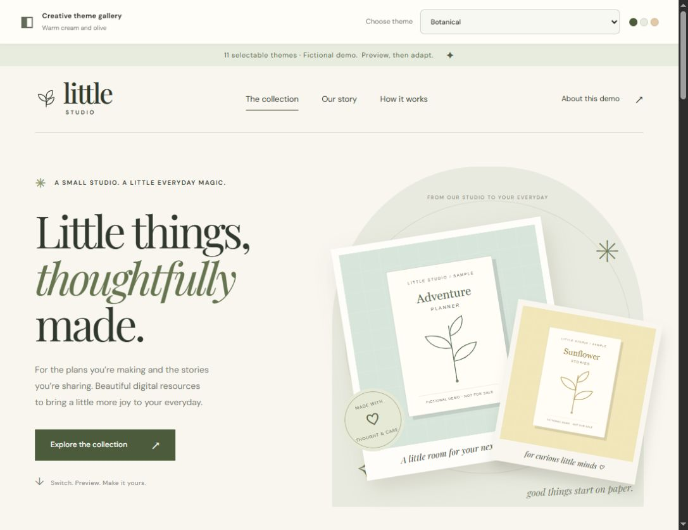](docs/screenshots/botanical.jpg) | **02 · Editorial**<br>[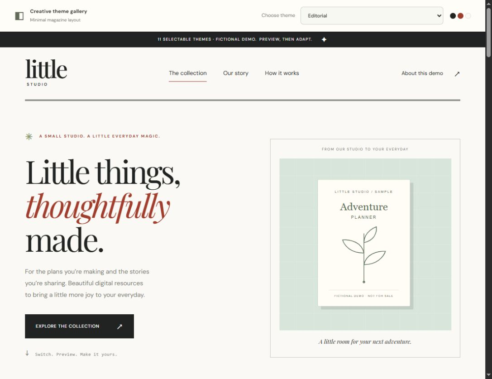](docs/screenshots/editorial.jpg) |
| **03 · Playroom**<br>[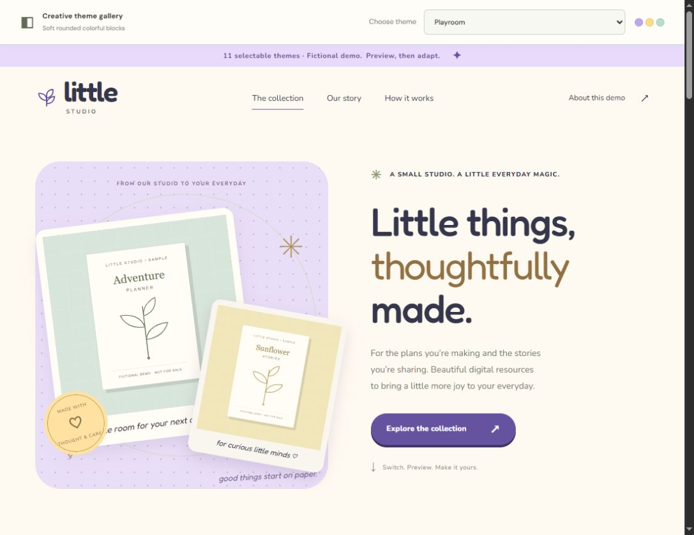](docs/screenshots/playroom.jpg) | **04 · Midnight**<br>[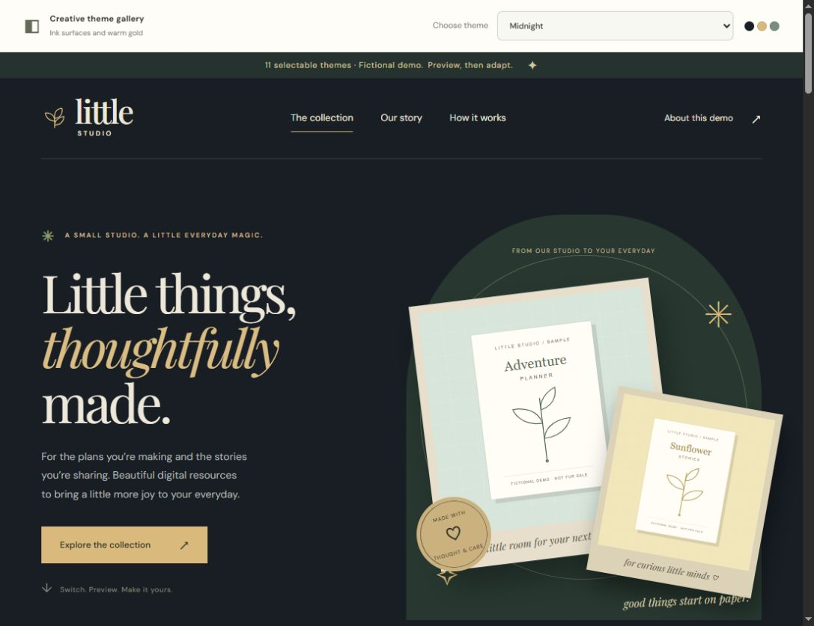](docs/screenshots/midnight.jpg) |
| **05 · Playful Retro Neo-Brutalism**<br>[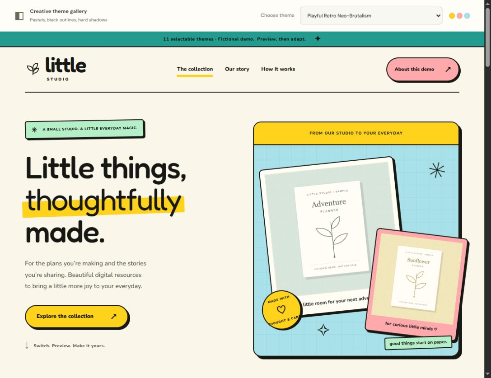](docs/screenshots/retro.jpg) | |

| Creative workspace collection | Creative workspace collection |
| --- | --- |
| **06 · Command line**<br>[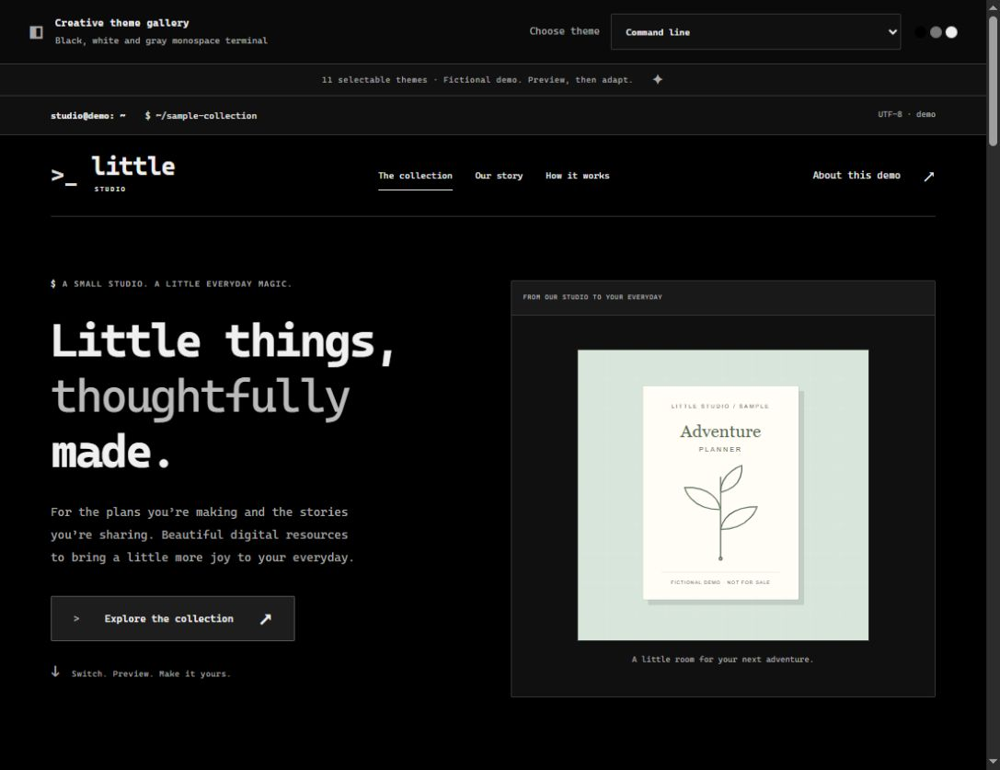](docs/screenshots/commandline.jpg) | **07 · Visual Studio Code**<br>[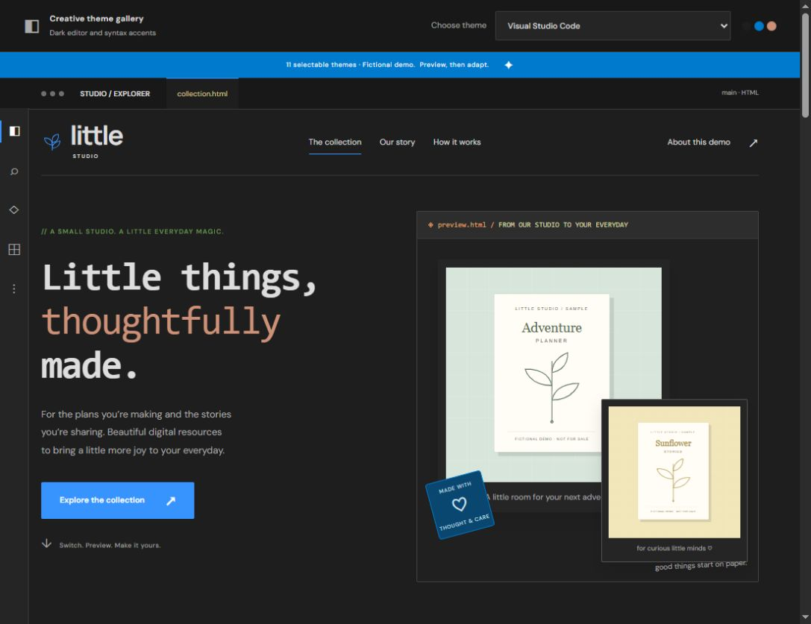](docs/screenshots/vscode.jpg) |
| **08 · Excel**<br>[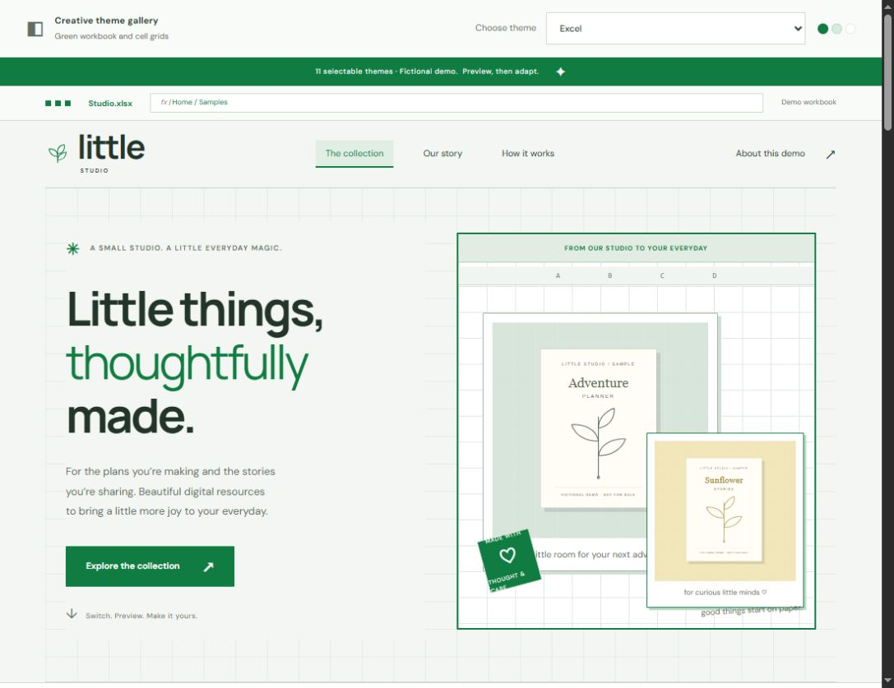](docs/screenshots/excel.jpg) | **09 · Canva**<br>[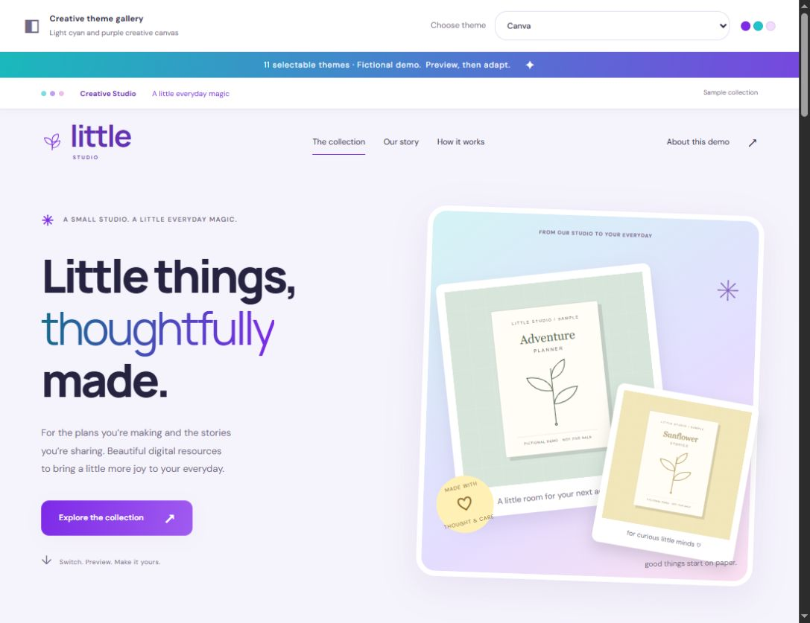](docs/screenshots/canva.jpg) |
| **10 · Figma**<br>[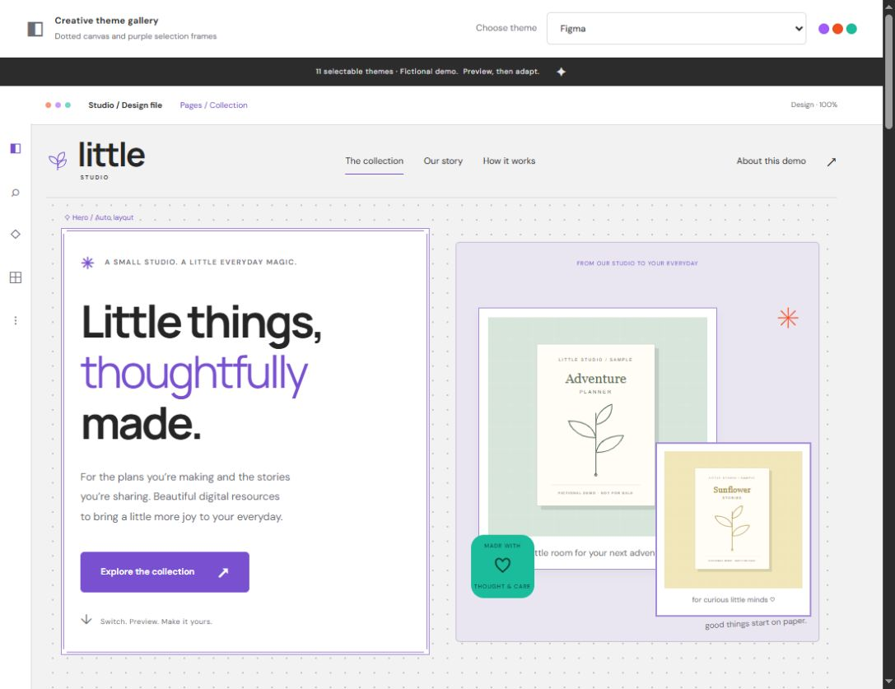](docs/screenshots/figma.jpg) | **11 · Photoshop**<br>[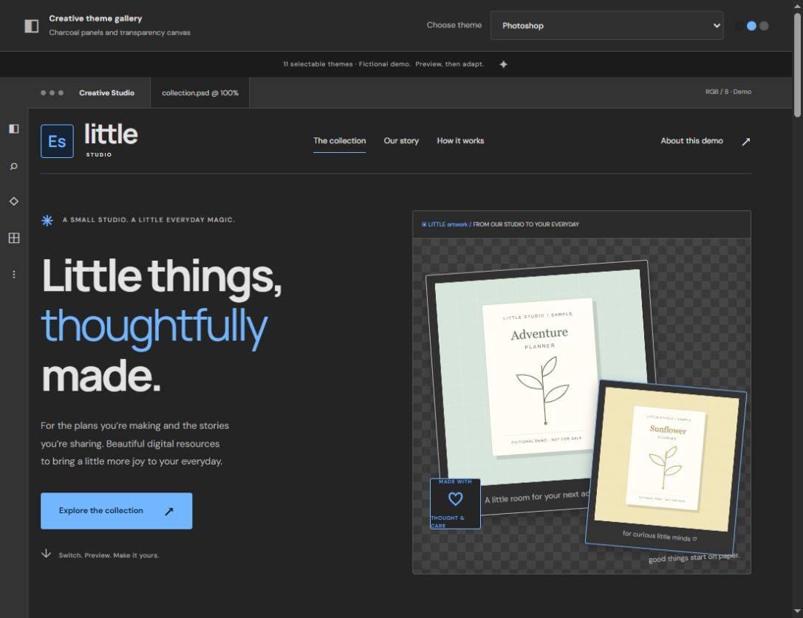](docs/screenshots/photoshop.jpg) |

## Use with an AI agent

```text
Read SKILL.md in this repository. Add the Command line and Retro themes to my
existing app using its current theme provider and selector. Preserve all existing
themes and business behavior. Verify desktop/mobile and report what you tested.
```

For Codex, copy this repository's contents, excluding `.git`, into `~/.codex/skills/creative-theme-system/`, then invoke `$creative-theme-system`. Other agents can read `SKILL.md` directly and follow the linked references. No connector or account is required for local theme work.

## Run the demo

Requires Node.js 18 or later. No dependencies or build step.

```sh
node scripts/create_demo.mjs ../theme-demo
node scripts/validate_demo.mjs ../theme-demo
node scripts/serve.mjs ../theme-demo --port 4173
```

Open `http://127.0.0.1:4173/?theme=commandline`. Use the dropdown to switch themes. Sample cards open a preview dialog; search, filtering and sample sorting work across selections. Fonts load optionally from Google Fonts with system fallbacks.

The generator refuses non-empty destinations. The preview server binds only to localhost. Publishing is optional and requires the user's authorization; [publishing guidance](references/publishing.md) covers GitHub/Vercel without embedding accounts or tokens.

## Layout

- `SKILL.md` — agent instructions and routing.
- `references/` — recipes, integration, validation and optional publishing.
- `assets/starter/` — reusable demo with original SVG sample assets.
- `scripts/` — dependency-free generation, serving and static verification.
- `agents/openai.yaml` — Codex discovery metadata.

Static validation checks registry metadata, assets, UI hooks and script syntax. Browser review remains necessary; see [verification](references/verification.md).

Initial package verification: all 11 theme selections, sample search across theme changes, preview dialog, stored selection and invalid-theme fallback were checked in a browser. Layouts were checked at 320px, 390px and 768px. The generator refused an occupied destination; the validator rejected duplicate IDs; the localhost server rejected POST and hidden-file requests.
